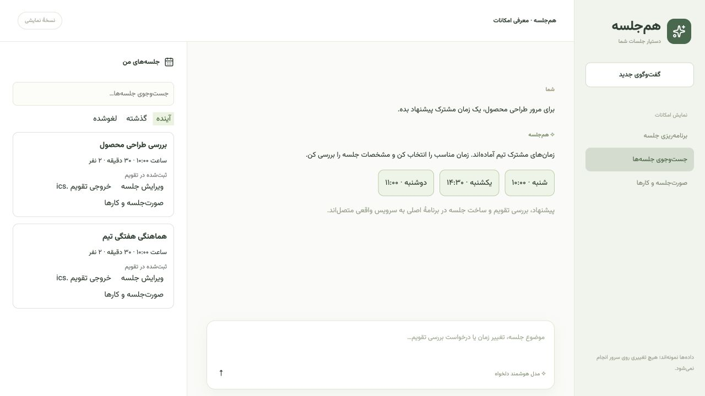
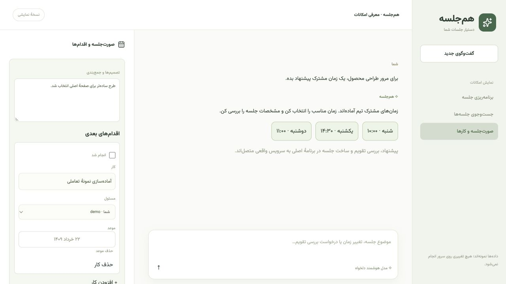

<div align="center">

# Hamjalase · هم‌جلسه

**A Persian-first meeting assistant for Nextcloud**

Plan meetings, find a shared time, create Talk links, and track decisions in one workspace.

[](https://github.com/Shayan83/hamjalase/actions/workflows/checks.yml)


[Features](#features) · [Quick start](#quick-start) · [Configuration](#configuration) · [Report an issue](https://github.com/Shayan83/hamjalase/issues)

</div>


## Overview

Hamjalase is a standalone web app that connects to your Nextcloud instance. Describe a meeting in chat, select participants from your user directory, and review the draft. The assistant can check calendar availability and suggest a shared time before creating a Talk room and a calendar event.

Connect your preferred **Chat Completions-compatible API** using its base URL, model name, and API key. The interface is designed for Persian, with right-to-left layouts, a Jalali date picker, and the Vazirmatn font.

## Features

| Area | Capabilities |
| --- | --- |
| Conversational planning | Prepare meeting drafts, search meetings, and propose rescheduling or cancellation for confirmation. |
| Availability | Select Nextcloud users, check conflicts, and suggest shared times. |
| Meeting management | Create Talk links and calendar events; edit meeting details and room membership. |
| Follow-up | Save minutes, decisions, and action items with owners, due dates, and completion status. |
| Accounts | Sign in with a Nextcloud account and keep account data separate. |
| Calendar export | Download `.ics` files for use in other calendar apps. |
| Connection settings | Configure and test the AI provider and Nextcloud connections. |

<details>
<summary>Workflow preview and screenshots</summary>

All previews use sample data.





</details>

## Quick start

### Requirements

- Node.js **24 or later** and npm.
- An existing Nextcloud instance with **Calendar** and **Talk** enabled.
- A Chat Completions-compatible AI service for conversational features.

### Installation

```sh
git clone https://github.com/Shayan83/hamjalase.git
cd hamjalase
npm ci
cp .env.example .env.local
```

Edit `.env.local` with your Nextcloud and AI provider settings, then start the app:

```sh
npm run dev
```

Open the address printed in your terminal. The `/demo` route provides a sample-data preview without connecting to Nextcloud or an AI provider. A hosted live demo is not currently available.

## Configuration

Use [`.env.example`](.env.example) as the configuration template.

| Variable | Purpose |
| --- | --- |
| `NEXTCLOUD_URL` | Nextcloud URL reachable by the application server. |
| `NEXTCLOUD_BROWSER_URL` | Nextcloud URL participants can use to open Talk links. |
| `NEXTCLOUD_CALENDAR` | Calendar identifier; defaults to `personal`. |
| `AI_BASE_URL` | Base URL of a Chat Completions-compatible API. |
| `AI_MODEL` | Model identifier supported by your provider. |
| `AI_API_KEY` | Your AI provider API key. |
| `SESSION_SECRET` | Random secret used to encrypt account sessions. |
| `APP_AUTH_REQUIRED` | Set to `true` for an internet-facing deployment. |

Generate a session secret and save it in `.env.local`:

```sh
node -e "console.log(require('crypto').randomBytes(48).toString('base64url'))"
```

Users sign in with their own Nextcloud username and app password. For a development-only account shortcut, see `NEXTCLOUD_USERNAME` and `NEXTCLOUD_PASSWORD` in the template. Internet-facing deployments require HTTPS and mandatory authentication.

The AI endpoint must accept `model`, `messages`, and `stream: false`, and return text in `choices[0].message.content`. Other native API formats require an adapter. Conversation text and meeting context are sent to the configured AI service.

For detailed account, availability, storage, and deployment behavior, see the [configuration guide](docs/configuration.md).

### Docker

The included Compose file runs the assistant against an **existing** Nextcloud instance:

```sh
docker compose up -d --build
```

Create `.env.local` first and ensure the Nextcloud URL is reachable from inside the container. The Dockerfile currently runs the development server and binds the published port to the host loopback interface. An internet-facing deployment needs an HTTPS gateway and the authentication settings above.

## Current scope

- This project is under active development.
- Availability checks depend on calendar permissions. Unknown availability is never treated as free.
- Shared-time suggestions currently search seven days from the selected date, between 09:00 and 18:00 in **Asia/Tehran**.
- The meeting list manages meetings created through Hamjalase; existing calendar events are not automatically imported.
- Events are saved in the organizer's calendar. Sharing uses Talk links and `.ics` exports; email delivery is not included.
- Talk rooms use public guest links. Removing a participant's room membership does not revoke access through a public link.

## Development

```sh
npm test
npm run typecheck
npm run build
```

The test suite covers session isolation, API key routing, calendar availability, idempotent creation, meeting updates, filtering, and calendar exports.

With a configured Nextcloud test instance, run the integration smoke test:

```sh
npm run smoke
```

It creates a temporary meeting, verifies replay, editing, notes, and calendar export, then cancels that meeting. See the [testing guide](docs/configuration.md#testing) for authenticated test settings.

## Contributing

Bug reports and pull requests are welcome. Include reproduction steps, expected behavior, and the relevant Nextcloud version when [opening an issue](https://github.com/Shayan83/hamjalase/issues). Run the checks above before submitting code changes.

## Secrets and privacy

Only the placeholder `.env.example` is included in the repository. `.env.local`, private hosting configuration, and generated runtime files are excluded by `.gitignore`. Keep API keys, passwords, session cookies, and private meeting data out of commits, issues, and screenshots.

AI provider keys configured on the server remain server-side and are not forwarded when a user switches to a different API endpoint. Meeting metadata is stored in the signed-in user's Nextcloud Files; conversation history is stored in the browser, scoped to the account.

## Acknowledgments

Built with React, Next.js-compatible tooling, Nextcloud Calendar, and Nextcloud Talk. Uses [Vazirmatn](https://github.com/rastikerdar/vazirmatn) by Saber Rastikerdar under the [SIL Open Font License](public/fonts/OFL.txt).
