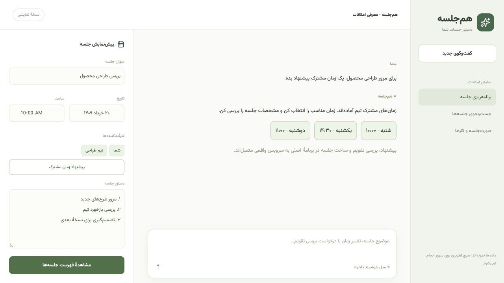
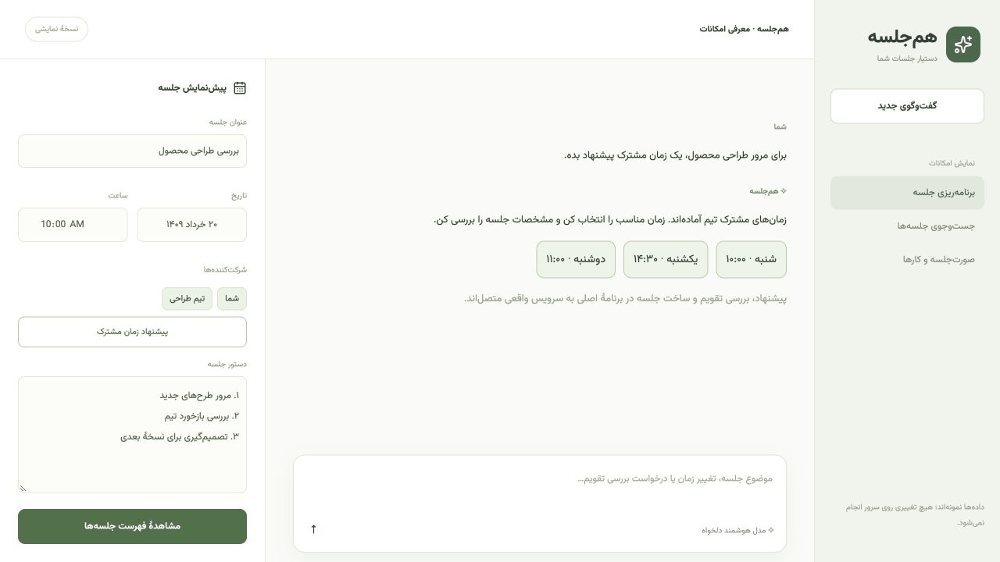

# هم‌جلسه | Hamjalase

دستیار فارسی مدیریت جلسه با Nextcloud، رابط راست‌به‌چپ، تاریخ شمسی و فونت Vazirmatn. سرویس مدل با آدرس API، نام مدل و کلید قابل انتخاب است.

## معرفی تصویری

[نسخهٔ نمایشی با داده‌های نمونه](http://localhost:5173/demo) بدون اتصال به سرویس‌ها، گردش کار رابط را نشان می‌دهد.




## امکانات

- گفت‌وگو برای آماده‌سازی، فهرست و جست‌وجوی جلسه، بررسی تقویم، پیشنهاد لغو و تغییر زمان و خواندن صورت‌جلسه
- ساخت لینک Talk و ثبت رویداد در تقویم سازمان‌دهنده؛ شناسهٔ پایدار برای جلوگیری از ساخت تکراری
- پیشنهاد زمان مشترک پیش از ساخت، در هفت روز از تاریخ انتخاب‌شده و ساعت ۹ تا ۱۸ تهران
- انتخاب کاربران واقعی؛ افزودن و حذف عضویت اتاق Talk هنگام ویرایش
- ویرایش عنوان، تاریخ، ساعت، مدت، دستور جلسه و شرکت‌کننده‌ها
- جست‌وجو و فیلتر جلسه‌های آینده، گذشته و لغوشده
- دریافت فایل `.ics` برای افزودن جلسه به تقویم‌های دیگر
- ثبت تصمیم‌ها، کارها، مسئول، موعد شمسی و وضعیت انجام
- تست اتصال مدل و Nextcloud با توضیح خطای آدرس، مدل، کلید یا دسترسی
- ورود با حساب Nextcloud و جداسازی اطلاعات حساب‌ها
- ذخیرهٔ حداکثر ۲۰ گفت‌وگو در مرورگر؛ پنج مورد آخر در منو قابل بازیابی است

## اجرای محلی

نیازمندی‌ها: Node.js نسخهٔ 24 یا بالاتر، npm و یک Nextcloud با Calendar و Talk فعال و تقویمی با شناسهٔ `personal`.

```sh
git clone https://github.com/Shayan83/hamjalase.git
cd hamjalase
npm ci
cp .env.example .env.local
```

فایل `.env.local` را با مشخصات سرویس مدل و Nextcloud پر کنید، سپس:

```sh
npm run dev
```

رابط در [localhost:5173](http://localhost:5173) باز می‌شود. نصب و build به ابزار محلی Codex وابسته نیستند.

## تنظیم مدل

| متغیر | کاربرد |
| --- | --- |
| `AI_BASE_URL` | آدرس پایه مانند `https://api.example.com/v1` |
| `AI_API_KEY` | کلید سرویس؛ برای مدل بدون احراز هویت می‌تواند خالی باشد |
| `AI_MODEL` | نام دقیق مدل موجود در سرویس انتخابی |

API باید قالب **Chat Completions** را پشتیبانی کند: درخواست `POST` شامل `model`، `messages` و `stream: false` و پاسخ متنی در `choices[0].message.content`. آدرس پایه یا آدرس کامل `/chat/completions` پذیرفته می‌شود. قالب‌های بومی دیگر به مبدل نیاز دارند.

آدرس عمومی باید HTTPS باشد. HTTP برای `localhost`، `127.0.0.1`، `[::1]` و `host.docker.internal` پشتیبانی می‌شود. در Docker برای مدل روی میزبان از `host.docker.internal` استفاده کنید.

تنظیمات نشست در رابط قابل جایگزینی‌اند و با رفرش پاک می‌شوند. کلید سرور به آدرس جایگزین فرستاده نمی‌شود. متن گفت‌وگو و مشخصات جلسه برای تولید پاسخ به سرویس انتخابی ارسال می‌شوند. مدیر استقرار باید سهمیه و هزینهٔ سرویس پیش‌فرض را متناسب با کاربران تنظیم کند.

## اتصال Nextcloud

| متغیر | کاربرد |
| --- | --- |
| `NEXTCLOUD_URL` | آدرس Nextcloud از دید سرور دستیار |
| `NEXTCLOUD_BROWSER_URL` | آدرس قابل دسترسی کاربران برای لینک Talk؛ پیش‌فرض همان آدرس بالا |
| `NEXTCLOUD_USERNAME` | حساب پیش‌فرض فقط برای میان‌بُر توسعهٔ محلی |
| `NEXTCLOUD_PASSWORD` | رمز برنامهٔ حساب پیش‌فرض توسعهٔ محلی |
| `NEXTCLOUD_CALENDAR` | شناسهٔ تقویم موجود؛ پیش‌فرض `personal` |

هر حساب باید بتواند فایل و رویداد تقویم خود را بخواند و بنویسد و اتاق Talk بسازد. بررسی زمان مشترک به دسترسی FreeBusy و مشخصات تقویمی افراد وابسته است؛ حساب محدود ممکن است نتواند اطلاعات لازم دربارهٔ دیگران را بخواند. در این حالت وضعیت «نامشخص» است و ساخت جلسه متوقف می‌شود. هیچ زمان نامعلومی آزاد فرض نمی‌شود.

## ورود کاربران و دسترسی اینترنتی

1. `APP_AUTH_REQUIRED=true` را تنظیم کنید.
2. یک `SESSION_SECRET` تصادفی با حداقل ۳۲ نویسه بسازید و در تنظیمات محرمانهٔ سرور قرار دهید:

```sh
node -e "console.log(require('crypto').randomBytes(48).toString('base64url'))"
```

3. برنامه را پشت HTTPS اجرا کنید. مقصد Nextcloud روی سرور ثابت است.
4. هر شخص با نام کاربری و رمز برنامهٔ حساب خودش وارد می‌شود. اطلاعات ورود با AES-GCM در کوکی HttpOnly و SameSite=Strict با عمر هشت ساعت رمز می‌شوند. در دسترسی عمومی کوکی Secure است. تغییر `SESSION_SECRET` نشست‌ها را نامعتبر می‌کند؛ این مقدار باید میان نمونه‌های یک استقرار یکسان باشد.

نشست واردشده از مشخصات حساب پیش‌فرض مدیر استفاده نمی‌کند. جلسه‌ها، صورت‌جلسه و درخواست‌ها در فضای همان حساب Nextcloud ذخیره می‌شوند. تغییر حساب در برگه‌ای دیگر تشخیص داده می‌شود تا درخواست برگهٔ قدیمی به حساب جدید اعمال نشود. تاریخچهٔ مرورگر هم با شناسهٔ حساب و سرور جداست؛ دادهٔ محلی رمزگذاری‌شده نیست و روی رایانهٔ مشترک از پروفایل مرورگر جدا استفاده کنید.

میان‌بُر بدون ورود فقط در حالت توسعه، روی hostname محلی و با `APP_AUTH_REQUIRED=false` فعال است. در دسترسی غیرمحلی ورود لازم است. محدودیت تلاش ورود داخل فرایند است؛ در استقرار چندنمونه‌ای محدودیت نرخ در درگاه ورودی هم لازم است. خروج کوکی مرورگر را پاک می‌کند؛ نسخهٔ کپی‌شدهٔ نشست تا انقضا یا تعویض کلید اعتبار دارد.

## ذخیره و بازیابی

- `Hamjalase-meetings.json` در Files حساب، فهرست مدیریت جلسه‌هاست. جلسه‌های قدیمی بیرون از این فهرست خودکار وارد نمی‌شوند.
- `Hamjalase-request-<UUID>.json` نتیجهٔ درخواست ساخت را نگه می‌دارد. تکرار همان درخواست نتیجهٔ قبلی را برمی‌گرداند؛ رزرو هم‌زمان با `If-None-Match` کنترل می‌شود. این فایل‌ها را تا وقتی امکان تلاش مجدد هست حذف نکنید.
- شناسهٔ درخواست و پیش‌نویس در مرورگر باقی می‌مانند. پس از قطع شبکه با همان پیش‌نویس دوباره تلاش کنید. اگر نتیجهٔ ساخت اتاق نامشخص باشد، درخواست رزروشده خودکار اتاق دیگری نمی‌سازد؛ ابتدا Talk و تقویم را بررسی کنید.
- تغییرات با ETag و نسخهٔ مورد انتظار کنترل می‌شوند. خطای جزئی صریح نمایش داده می‌شود و همگام‌سازی ناقص عنوان و افراد Talk قابل تکرار است.
- در تغییر زمان، تقویم افراد بررسی می‌شود. بازهٔ قدیمی سازمان‌دهنده فقط با تأیید UID و زمان رویداد ذخیره‌شده از بررسی دوباره کنار گذاشته می‌شود؛ بخش‌های تازه بررسی می‌شوند.
- لغو، رویداد و اتاق Talk را همراه تاریخچه حذف می‌کند و تأیید صریح لازم است. صورت‌جلسه در فهرست لغوشده باقی می‌ماند.
- رویداد در تقویم سازمان‌دهنده ثبت می‌شود. خروجی تقویم، گیرندهٔ زمان‌بندی ندارد.

## Docker با Nextcloud موجود

```sh
docker compose up -d --build
```

`compose.yaml` فقط دستیار را اجرا می‌کند. `.env.local` باید وجود داشته باشد. آدرس `NEXTCLOUD_URL` را برای دسترسی از داخل کانتینر تنظیم کنید؛ آدرس لینک مرورگر می‌تواند متفاوت باشد. Dockerfile سرور توسعه را اجرا می‌کند و پورت فقط روی loopback میزبان منتشر می‌شود؛ برای دسترسی اینترنتی درگاه HTTPS لازم است.

## بررسی پروژه

```sh
npm test
npm run typecheck
npm run build
```

تست واقعی روی Nextcloud محلی با میان‌بُر توسعهٔ فعال:

```sh
npm run smoke
```

تست فقط جلسهٔ موقت خودش را می‌سازد، درخواستش را تکرار می‌کند، ویرایش و صورت‌جلسه و خروجی را بررسی می‌کند و همان جلسه را در پایان لغو می‌کند. با `SMOKE_TEST_MODEL=1` اتصال مدل هم تست می‌شود. برای نمونهٔ دارای ورود اجباری، `SMOKE_BASE_URL`، `SMOKE_SESSION_COOKIE` و `SMOKE_ACCOUNT` را فقط در محیط محلی تست تنظیم کنید؛ کوکی را در فرمان عمومی، issue یا log منتشر نکنید.

آزمون‌های واحد جداسازی دو هویت، رمزنگاری و انقضای نشست، درخواست هم‌زمان، بازپخش نتیجه، فیلترها، صورت‌جلسه، خروجی تقویم، FreeBusy و تغییر بازهٔ هم‌پوشان را پوشش می‌دهند. ورود حساب موجود و مسیر واقعی جلسه روی Nextcloud محلی آزمایش شده‌اند؛ تست دو حساب مستقل روی سرور واقعی در این محیط انجام نشده است.

## ساختار کد

- `app/components`: چت، ورود، تنظیمات، پیش‌نویس، فهرست، ویرایش و صورت‌جلسه
- `app/hooks/use-conversations.ts`: گفت‌وگوهای تفکیک‌شده بر اساس حساب
- `app/lib/agent-service.ts`: عملیات واقعی Nextcloud
- `app/lib/auth.ts` و `connection.ts`: نشست و انتخاب حساب مجاز
- `app/lib/idempotency.ts`: رزرو و بازیابی درخواست ساخت
- `app/lib/availability.ts` و `rescheduling.ts`: تقویم و بررسی تغییر بازه
- `app/demo`: معرفی رابط با دادهٔ نمونه، بدون اطلاعات واقعی

## انتشار در Git

کد و `.env.example` قابل انتشارند. `.env.local`، رمزها، خروجی build، فایل‌های وضعیت ابزار و شناسهٔ شخصی میزبانی نادیده گرفته می‌شوند. مخزن عمومی پروژه: [Shayan83/hamjalase](https://github.com/Shayan83/hamjalase).

فونت Vazirmatn از صابر راستی‌کردار با مجوز SIL OFL در `public/fonts/OFL.txt` قرار دارد. مجوز بخش‌های همراه در فایل‌های LICENSE مربوط به خودشان نگهداری شده‌اند.
